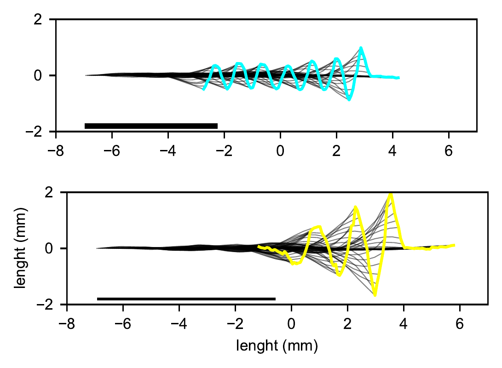
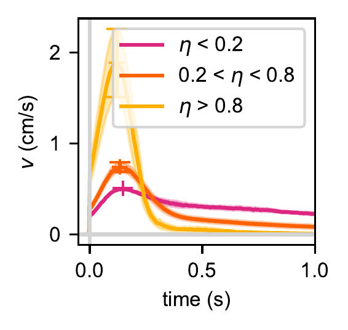

# locomotor-transition-development

**Analysis code for _A sensorimotor instability drives a locomotor transition during fish development_ (Science Advances, 2026).**

[](https://doi.org/10.5281/zenodo.17650136)
[](https://doi.org/10.1126/sciadv.aec6922)


Between 2 and 5 weeks after fertilisation, the larvae of the fish *Danionella cerebrum* switch from **continuous swimming** to **intermittent burst-and-glide swimming**. Using high-resolution posture tracking of freely swimming fish over development, virtual-reality and sensory-manipulation experiments, CFD simulations and a delayed-feedback model, we show that this transition arises from an instability in the sensorimotor loop that controls swimming speed.

This repository contains the notebooks and modules that produce **every main and supplementary figure** of the paper. The data were acquired with my real-time tracking software, **[fish-realtime-tracking](https://github.com/MonicaCoraggioso/fish-realtime-tracking)**.

<p align="center">
  
  
</p>
<p align="center"><sub>Left: tail kinematics of a young, continuous swimmer (top) and an older, intermittent swimmer (bottom) (Fig. 1e). Right: speed at bout onset, grouped by intermittency index η (Fig. 3a).</sub></p>

---

## Quick start

```bash
git clone https://github.com/MonicaCoraggioso/locomotor-transition-development.git
cd locomotor-transition-development

conda env create -f environment.yml        # or: pip install -r requirements.txt
conda activate analysis-transition

python scripts/download_data.py analysis   # fetches data/ and input_data/ from Zenodo (~13 GB)
jupyter lab code/
```

Every notebook starts by importing its paths from [`code/paths.py`](code/paths.py), so it runs on any machine without editing paths. Figures are saved to a `media/` folder next to each notebook.

## Repository layout

```
├── code/
│   ├── paths.py, setup_imports.py   # single source of truth for all paths
│   ├── functions/                   # shared analysis, modelling and plotting modules
│   ├── clean_and_segment_speed/     # 1 → 4: open, clean, segment bouts, analyse spontaneous swimming
│   ├── postural_space/              # PCA of body shape (eigenshapes) and run alignment
│   └── <analysis>/                  # one folder per analysis, see the table below
├── cfd/                             # CFD efficiency analysis (Fig. 2d–g, S6)
├── scripts/download_data.py         # downloads and unpacks the Zenodo data
├── data/, input_data/               # created by the download script (ignored by git)
└── environment.yml, requirements.txt
```

## Figure → code map

| Figure | Notebook(s) |
|---|---|
| 1e | `code/midline_dynamics/plot_develop_midline_traces.ipynb` |
| 1f, S3a–c | `code/on_off/analyze_onoff_statistics.ipynb`, `plot_onoff_definition.ipynb` |
| 1h, 3c, S4a, S7b–c | `code/intermittency_index/compute_intermittency_index.ipynb` |
| 2b | `code/speed/analyze_speed_statistics.ipynb` |
| 2d–g, S6b–f | `cfd/` (see [cfd/README.md](cfd/README.md)) |
| 3a–c, S7a, S8a–c | `code/onset_speed/*.ipynb` |
| 4b–e, S12 | `code/delayed_feedback_model/*.ipynb` |
| 5c–d | `code/virtual_reality_experiments/bout_durations_{2,4}_wpf.ipynb` |
| S2f–g | `code/tail_frequency/analyze_tail_frequency.ipynb` |
| S4b | `code/bout_durations/compute_bout_durations_all_fish.ipynb` |
| S9 | `code/speed_modulations/analyze_speed_modulations.ipynb` |
| S10 | `code/strouhal_number/compute_strouhal_all_fish.ipynb` |
| S11, S13 | `code/manipulation_experiments/*.ipynb` (darkness, lateral-line ablation, viscosity, zebrafish) |

**Run order.** The notebooks in `clean_and_segment_speed/` (numbered 1–4) produce the cleaned speeds, thresholds and bout onsets in `data/speed_segmented/` that the other analyses read. The Zenodo archive already contains these intermediate files, so you can also open any analysis notebook directly.

## Data

All data are on Zenodo, **[10.5281/zenodo.17650136](https://doi.org/10.5281/zenodo.17650136)** (CC BY 4.0), and none are stored in git.

| Folder | Content |
|---|---|
| `input_data/` | Analysis-ready posture and speed tables for all fish (`POSE.h5`, `SPEED.h5`, `THETA_obs.h5`), built by [`data_processing/`](https://github.com/MonicaCoraggioso/fish-realtime-tracking/tree/main/data_processing) |
| `data/speed_segmented/`, `data/speed_onsets/` | Cleaned speeds, bout thresholds and onsets, per-fish statistics |
| `data/virtual_reality/` | Virtual-reality experiments |
| `data/manipulation_experiments/` | Darkness, lateral-line ablation, viscosity (Danionella and zebrafish) |
| `data/cfd/` | CFD simulation inputs and outputs (`python scripts/download_data.py cfd`) |

## Methods in brief

- **Kinematics.** Body midline as segment angles, centre-of-mass trajectory and heading.
- **Bout segmentation.** Speed thresholding of thrust onsets and offsets, intermittency index η, ON/OFF duration statistics.
- **Posture space.** PCA of segment angles (eigenshapes) and comparison across ages.
- **Model.** Delayed-feedback speed controller fitted to the speed profiles at bout onset (`functions/feedback_models.py`, lmfit), including stability analysis in parameter space.
- **Physics.** Reynolds number, Strouhal number, and CFD to extract energetic efficiency of continuous vs. burst-and-coast swimming.

## Citation

```bibtex
@article{coraggioso2026sensorimotor,
  title   = {A sensorimotor instability drives a locomotor transition during fish development},
  author  = {Coraggioso, Monica and Demarchi, Leonardo and Wong, Robert and Dichio, Vito and
             Chaumeton, Chlo{\'e} and Panier, Thomas and Morvan-Dubois, Ghislaine and
             Goodhill, Geoffrey and Bormuth, Volker and Debr{\'e}geas, Georges},
  journal = {Science Advances},
  year    = {2026},
  doi     = {10.1126/sciadv.aec6922}
}
```

See also [`CITATION.cff`](CITATION.cff) for the Zenodo archive.

## Contributors

Analysis code by **Monica Coraggioso** ([ORCID](https://orcid.org/0009-0004-2091-3592)) and **Leonardo Demarchi** (delayed-feedback modelling and shared analysis modules), with posture PCA by **Vito Dichio** and CFD by **Robert Wong**.

## License

Code: [MIT](LICENSE). Data: CC BY 4.0 (Zenodo).
